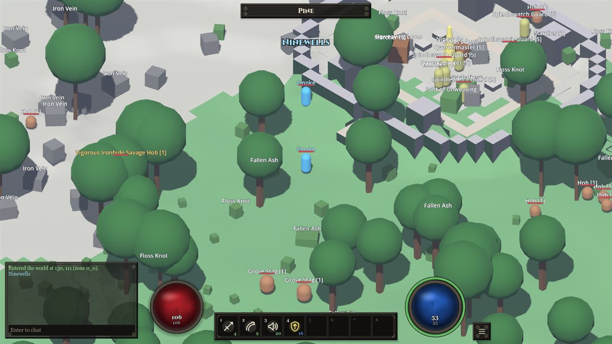
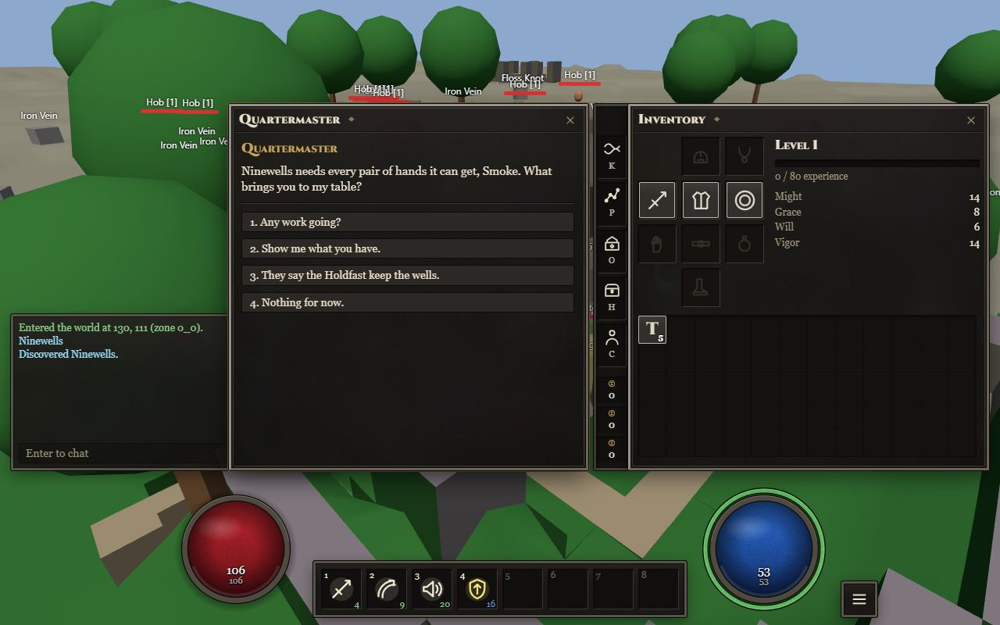

<!--
  This page is a durable overview: it names nothing that ordinary development changes. No counts, rosters,
  file maps, command inventories or version strings; those went stale within weeks in the earlier prototype.
  Living facts ride the badges, which read GitHub. The test for a new line: would a session adding content
  or a system ever need to edit it? If yes, it belongs in CLAUDE.md or docs/. Edit this file when the
  game's identity, how it is played or how it is built changes.
-->

<p align="center"></p>

<h1 align="center">Hollow Wake MMO</h1>

<p align="center"><b>An online action RPG where every rule, number, creature, place and system is data, and the world is one seamless generated land.</b></p>

<p align="center">
  <a href="https://github.com/arianna-arpg/hollow-wake-mmo/releases/latest"></a>
  <a href="https://github.com/arianna-arpg/hollow-wake-mmo/releases"></a>
  <a href="https://github.com/arianna-arpg/hollow-wake-mmo/actions/workflows/ci.yml"></a>
  <a href="https://github.com/arianna-arpg/hollow-wake-mmo/actions/workflows/pages.yml"></a>
  <a href="LICENSE.md"></a>
</p>

Hollow Wake MMO is a server-authoritative online action RPG set in **Aureth**, a high-fantasy world woven from Threads. Players arrive in the Weftmarches, a frontier of generated regions, zones and chunks seeded with hand-placed landmarks, points of interest and the quests those places give rise to. They fight with weaves they compose from forms, Threads and glyphs, loot and reweave gear, bind Founts to raise Holdings, and grow a character whose build is theirs to invent. The default view is isometric, like the games the genre began with; the camera can drop behind the character's shoulder, because the world was fully three-dimensional all along.

The commitment behind it: **the game is data, and the engine is a set of mechanisms that data composes.** Every attribute, status, weave, item, creature, biome, quest template and rule is content. One modifier engine folds every number. Tags are the universal join. Players, monsters and summons act through one pipeline. The server decides and the clients draw. The world is deterministic from a seed, so a fight, a drop or a zone can be replayed. [docs/VISION.md](docs/VISION.md) is the long form, and the test for every change.

> **Status:** a foundation in active development, not a game yet. The simulation runs end to end, headless and over the network: characters, movement with jumping and stacked surfaces, weaves and projectiles, damage, statuses, loot, quests generated from the world, crafting verified by the server, fount binding and holdings, world events that reshape generation. Presentation is placeholder geometry, there is no audio, and characters may be reset between versions. [docs/ROADMAP.md](docs/ROADMAP.md) has the order of what follows.

---

## Play

Hollow Wake MMO is a client and a server. Pick a client, then point it at a server: one you run yourself, or one somebody shares with you.

- **The desktop client, through the launcher.** Take the Windows installer or the Linux AppImage from the [latest release](https://github.com/arianna-arpg/hollow-wake-mmo/releases/latest). Windows installs for the current user, no admin needed; on Linux, `chmod +x` the AppImage and run it. The launcher installs the game and keeps it updated from GitHub Releases, checking every download against the release's manifest, and keeps itself updated from stable releases. Enter a server in its Server field (`127.0.0.1:7777` is a server on your own machine) and press Play. The channel toggle switches between stable releases and nightly pre-releases for testers; the build picker can pin a published version. Play remains available while updates are checked or downloaded. Builds are not code-signed yet, so Windows SmartScreen may ask before the first run. [docs/design/launcher.md](docs/design/launcher.md) describes the launcher, the releases and the channels.
- **In the browser, from GitHub Pages.** [Play the web client](https://arianna-arpg.github.io/hollow-wake-mmo/), published from main whenever it changes. The branch ribbon opens a Codespace running that branch's own client and server. The page is only the client: type the address of a running server into its Server field, or open a link that carries one (`?server=wss://host/ws`). The page is served over HTTPS, so the server has to be reachable over `wss://`, which a Codespace or a reverse proxy provides; a server on your own machine is best played from the page it serves itself.
- **In the browser, from the server.** A running server serves the web client at its own address, `http://localhost:7778/` for one on your machine. The page finds the server at its own origin, so you only press Connect.
- **With nothing installed.** Open a Codespace on the repository and follow [docs/infrastructure/codespaces.md](docs/infrastructure/codespaces.md). A few minutes later the server runs on GitHub's machines and serves the web client at an address other people can join.

Development servers accept any account name and create the account on first use. Make a character, press Enter the Weft and walk out of the starting hamlet.

| The desktop client | The web client |
|---|---|
|  |  |

The scripted play-throughs take these: `godot --path src/HollowWake.Client -- --smoke --shots DIR` and `npm --prefix web run smoke -- --shots DIR`, each against a local server.

---

## Local playtesting

For a quick Windows playtest, double-click **Play.cmd**. It prepares the browser build, starts a local server and opens the game. Later runs reuse the build and server. **Play Desktop.cmd** opens the Godot client instead; configure its editor path once with `Play.cmd --desktop --godot "path to Godot .NET.exe"` or `HOLLOWWAKE_GODOT`. **Stop Playtest.cmd** saves and stops this checkout's server. The first session creates a character; later sessions resume the remembered character through the shared Wisp-Mu Crossing, which closes as soon as the hero and nearby terrain are ready. Ports and the playtest account are in `config/playtest.json`; errors and logs stay visible under `artifacts/playtest/`.

On Linux/macOS use `node scripts/play-local.mjs` (`--desktop` for Godot, `--stop` to stop). The initial build needs the prerequisites below; unchanged repeat starts skip it.

For cloud browser play, [open or resume a Codespace](https://codespaces.new/arianna-arpg/hollow-wake-mmo?quickstart=1). It is configured to start the server and open the browser port automatically; the cloud lifecycle still needs its first end-to-end verification. The [GitHub Pages client](https://arianna-arpg.github.io/hollow-wake-mmo/) includes a branch picker for branch-specific Codespaces and a desktop-launcher download link. First-time Codespace setup takes a few minutes. Pages itself hosts only the client; use a Codespace or local server for the simulation.

The initial build uses the prerequisites in [local-dev.md](docs/infrastructure/local-dev.md).

## Host a server

```bash
dotnet run --project src/HollowWake.Server.Host
```

One process serves the desktop client over TCP and, beside it, the WebSocket socket and the web client itself. [config/server.yaml](config/server.yaml) holds the settings (copy it to `server.local.yaml` for machine-specific overrides): ports, tick and snapshot rates, interest radius, content layers, the data folder, open or token-gated login. Accounts, characters and the changed world are kept as JSON under `data/`. Players enter the address: `host:7777` in the launcher, `host:7778` or a `wss://` address in the web client.

For a machine on the internet, [deploy/](deploy/) has a Dockerfile, a Compose file and a VPS bootstrap, and [docs/infrastructure/hosting.md](docs/infrastructure/hosting.md) is the researched plan from a one-box starter to zone-sharded processes.

```bash
docker compose -f deploy/docker-compose.yml up -d --build
```

---

## Build and verify

Requires the .NET SDK, Godot .NET edition for the desktop client, and Node for the web client and the launcher; [docs/infrastructure/local-dev.md](docs/infrastructure/local-dev.md) names the versions and the everyday loop.

```bash
dotnet build HollowWake.sln                                    # everything, including the Godot client assembly
dotnet test HollowWake.sln                                     # all tests
dotnet run --project src/HollowWake.Tools -- validate           # content must report 0 errors
dotnet run --project src/HollowWake.Tools -- load --x 0 --y 0   # a zone, headless
dotnet run --project src/HollowWake.Tools -- fight a b          # a duel, with its event trace
npm --prefix web ci && npm --prefix web run build               # the web client into web/dist
```

Open `src/HollowWake.Client/project.godot` in Godot and press play for the desktop client. Every change passes the verification gates in [CLAUDE.md](CLAUDE.md) before it is called done: build, tests, content validation, and the headless, loopback, client, web and launcher checks for whatever it touched. CI runs the build, the tests, the validation and the headless smoke on every push and pull request; the release and nightly workflows export the client, build the launcher and publish both; the pages workflow publishes the web client.

---

## The repository

| Part | What it is |
|---|---|
| `src/HollowWake.Core` | The simulation: attributes and modifiers, expressions, content layers, entities, weaves and effects, combat, statuses, items, loot, AI, minions, quests, crafting, territory, world generation, movement with z-levels. No engine, no sockets. |
| `src/HollowWake.Protocol` | Every message between client and server, and the generator for the web client's types. |
| `src/HollowWake.Server` | Sessions, zones, interest management, snapshots, persistence, world events. Hosted by `HollowWake.Server.Host` (TCP and WebSocket) or `HollowWake.Server.Host.Brutal` (RakNet UDP through BRUTAL). |
| `src/HollowWake.Client` | The Godot desktop client: generates the same terrain locally from the server's seed, draws placeholder bodies, and offers an isometric and a third-person camera over one fully 3D world. |
| `web/` | The browser client in TypeScript and three.js: the same views, cameras and interface over WebSocket, with terrain sent by the server. |
| `launcher/` | The desktop launcher players install: it installs and updates the desktop client from GitHub Releases and starts it. No game logic. |
| `src/HollowWake.Tools` | The `hollowwake` command line: validate content, explain weaves, lint the passives, roll items, simulate fights, describe generated zones, run a zone headless, probe a live server, bench. |
| `content/core` | The base content layer. Everything the engine runs comes from here; `rules.yaml` holds every formula and tunable. |
| `docs/` | The vision, the architecture, one contract per system, the lore, hosting, decision records, review records. |
| `deploy/`, `config/` | Dockerfile, Compose, VPS bootstrap; the server settings. |
| `scripts/`, `.devcontainer/` | `play-local.mjs` (the shared automatic startup behind Play.cmd and Play Desktop.cmd), `codespace-play.sh` (the cloud entry point), `package-client.sh` (the desktop client's release archives), `branches.sh` (where every branch stands against main); the Codespaces container. |
| `.github/` | CI, the Pages build, the release and nightly pipelines, the weekly branch report, the pull request template. |

[CLAUDE.md](CLAUDE.md) has the map in full, down to the files where each open set registers.

---

## Content and modding

Everything the engine runs comes from content layers: directories of YAML files that declare a kind and its entries. A later layer replaces, patches or removes entries of an earlier one, so a mod is a layer listed after `content/core` in the server's settings, and the engine already knows how to run what it declares. A new monster, biome, weave, affix, quest template or decree is a content change, not a code change. [docs/modding.md](docs/modding.md) explains the file shape, layering, expressions, tags and validation.

---

## Where the truth lives

| If you want | Go to |
|---|---|
| The vision and the pillars every change is measured against | [docs/VISION.md](docs/VISION.md) |
| How the pieces fit, the data flow, the scaling path | [docs/ARCHITECTURE.md](docs/ARCHITECTURE.md) |
| One system in depth | [docs/design/](docs/design/), one contract per system |
| The launcher, releases and update channels | [docs/design/launcher.md](docs/design/launcher.md) |
| The world's lore | [docs/lore/](docs/lore/) |
| Adding or changing content, writing a mod | [docs/modding.md](docs/modding.md) |
| Running locally, in a Codespace, in Docker, on a VPS | [docs/infrastructure/](docs/infrastructure/) |
| Why a decision was made | [docs/adr/](docs/adr/) |
| What comes next | [docs/ROADMAP.md](docs/ROADMAP.md) |
| The commands, the verification gates, the conventions | [CLAUDE.md](CLAUDE.md) |

---

## Working here

Two kinds of engineer work in this repository, Claude sessions and Codex chats, and the same rules bind both: a branch in its own worktree, a clean integration tree, main through pull requests reviewed by the other side with the `ci` check green, review records under `docs/reviews/`, evidence for every claim, and branches that live days, not weeks. [docs/COLLABORATION.md](docs/COLLABORATION.md) is that contract, [AGENTS.md](AGENTS.md) is where a Codex chat starts, and [CONTRIBUTING.md](CONTRIBUTING.md) is the short form for anyone else. The pull request template carries the gates and the evidence sections; the weekly branch report names what lingers.

---

## License

[PolyForm Noncommercial 1.0.0](LICENSE.md). Read it, run it, mod it, fork it and share it for any noncommercial purpose. Commercial use needs the author's permission first. The name and the insignia stay with the project. BRUTAL, used by the optional RakNet server host, is Copyright (c) 2024 Ahwoo Limited under its own licence.

---

Made by Arianna.
