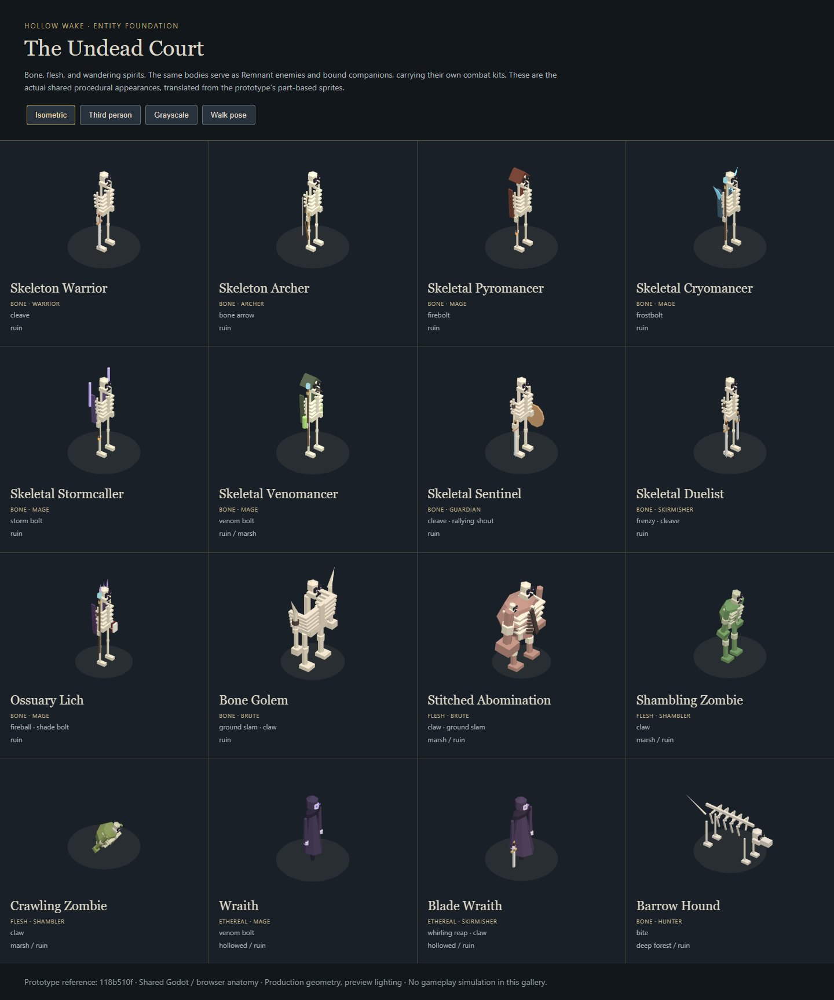

# Undead entity foundation

This pass translates the local Hollow Wake ARPG prototype at `118b510f8b5bfb781163c5bc13ea4908f698e75b` into reusable MMO encounter and summon content. The source is reference material only; no prototype checkout is needed to build or run this repository. Exact source files, look ids and deferred mechanics are recorded in [provenance.json](provenance.json).

## Implemented roster

| Body | Active MMO kit | Habitat classifiers |
| --- | --- | --- |
| Skeleton Warrior | cleave | ruin |
| Skeleton Archer | bone_arrow | ruin |
| Skeletal Pyromancer | firebolt | ruin |
| Skeletal Cryomancer | frostbolt | ruin |
| Skeletal Stormcaller | storm_bolt | ruin |
| Skeletal Venomancer | venom_bolt | ruin, marsh |
| Skeletal Sentinel | cleave, rallying_shout | ruin |
| Skeletal Duelist | frenzy, cleave | ruin |
| Ossuary Lich | fireball, shade_bolt | ruin |
| Bone Golem | ground_slam, claw | ruin |
| Stitched Abomination | claw, ground_slam | marsh, ruin |
| Shambling Zombie | claw | marsh, ruin |
| Crawling Zombie | claw | marsh, ruin |
| Wraith | venom_bolt | hollowed, ruin |
| Blade Wraith | whirling_reap, claw | hollowed, ruin |
| Barrow Hound | bite | deep_forest, ruin |

The bodies use Remnant allegiance when wild. Summons inherit their owner's effective allegiance and minion investments, follow commands through the existing minion AI, and cannot award wild loot or experience. New summon presets cover individual roles, the random four-school mage pool, mixed skeleton/zombie raising, corpse-consuming Raise Zombie, decaying wraiths and the reserved, respawning bone-golem contract. The bone golem shares the existing warden exclusivity pool. Existing `call_wraiths` now uses the actual wraith body and ranged minion AI while keeping its authored wave/decay terms.

The roster enters roaming tables in marsh, deep forest and hollowed terrain, plus ossuary, grave-court and charnel-yard sites under the existing ruin budget. Site inhabitants now respect their authored level windows. The site's political faction still follows its region; the hostile inhabitants retain Remnant allegiance.

## Visual translation

The prototype's part-based sprites supply the visual grammar: visible rib cages and skulls; sword, bow and twin blades; a cowl, crystal fan, conductor yoke or venom mask/vials for the four schools; bound bone and shoulder spikes for the golem; flesh mass, burial harness and grafts for the abomination; hooded tatters for spirits; exposed ribs and a low skull for the hound. The crawler has no drawn legs. New reusable families build these on the existing animated rigs in both clients. These are procedural foundation models, not final sculpted assets or bespoke animation sets.

[Third-person angle](evidence/undead-third-person.jpg) and [grayscale walk poses](evidence/undead-grayscale-walk.jpg) are actual browser geometry captures. [Render report](evidence/render-report.json) records primitive counts and browser errors. Screenshots are kept below a few hundred kilobytes each.

Run `npm --prefix web ci`, then `node experiments/undead-entities/render.mjs` from the repository root. This opens only a headless browser, renders every look with its equipment, captures the gallery and closes its owned processes. `--write-fixture` deliberately refreshes the shared plan fixture after reviewing an intentional visual change; ordinary rendering never updates test expectations. Vite's cache lives under ignored `artifacts/`.

## World evidence

The `world-before-*` and `world-after-*` text captures use seed `aureth`, the root baseline world content and this branch's content. In zone `(1,0)`, an ossuary replaces the Fallen Hall at the same placement; its barrow landmark and later spacing decisions change that zone's chunks. Other sampled zones keep their chunk hashes, while their zone-info hashes change because the hash includes neighboring sites. Climate samples and regions retain their original golden hash. The explicit low/high site-level test verifies skeletal inhabitants, delayed golems and seeded replay before goldens are updated.

## Limits and review

Current MMO attacks are used where the prototype's dedicated skills have not landed. School-specific skeleton trees, court upgrade/perk systems, bespoke duel cuts, corpse-graft interactions, healing clerics, larger summon rosters and living fauna remain follow-up content. Geometry and kit mapping are traceable foundations, not a claim of exact visual or numerical parity. No new Calling loadout, progression unlock or loot economy is introduced.

Gate logs live in `evidence/gates/`; transient client profiles, servers and full smoke captures live under ignored `artifacts/`. The review record is [docs/reviews/2026-10-17-undead-entity-foundation.md](../../docs/reviews/2026-10-17-undead-entity-foundation.md). Native headless smoke cannot verify GPU rendering; the paired plan fixture verifies native/browser anatomy while the gallery supplies browser pixel evidence.
